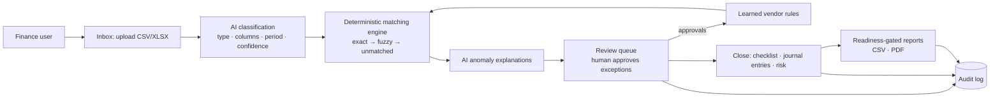

# FinOpsAi

**An AI-assisted month-end close workspace: AI organizes the finance data first, and people approve only the exceptions.**

---

## The problem & who it's for

FinOpsAi is for **CFOs, controllers, and small finance teams at growth-stage companies** that still close their books in spreadsheets.

The most painful part of the close sits between raw bank data and clean financial statements. Teams reconcile bank lines against invoices by hand, chase unexplained differences, and then rebuild reports from scratch. General ledgers, corporate-card tools, and spend platforms each cover a different layer. This reconciliation layer stays manual and error-prone.

The goal is to cut the close from **days to roughly one day**. This is a product target, not a measured result.

## Product decisions & trade-offs

- **Workflow-first navigation, not module-first.** The first version was organized around engineering modules (Dashboard, ReconcileAI, Exceptions, CloseOS). I restructured it around how a finance team actually works: **Inbox → Review → Reports → Close → Audit**.
- **"AI organizes first, human approves exceptions."** Matching is deterministic and explainable. The LLM classifies files, explains anomalies, and drafts suggestions, but it never makes final accounting decisions.
- **Trust UX as a core feature.** Every AI output shows a confidence score, its reasoning, and an evidence trail (upload → classification → match → review). Every item moves through explicit states (AI draft → needs review → approved → locked).
- **An honest self-audit before adding features.** A full-system audit scored launch readiness at **35/100**. It found 42 issues, and about 60% of the advertised features turned out to be demo-only. I paused new features and ran a 10-phase hardening plan. That plan wired real data into the close checklist and journal entries and added input validation, rate limiting, an audit log, error monitoring, and automated tests.
- **What was cut or deferred:**
  - PDF parsing was deferred. CSV/XLSX come first.
  - A dedicated PDF rendering library was replaced with server-rendered print HTML, which is simpler and has fewer dependencies.
  - Bank feeds and accounting-software sync moved to a later phase, so the core loop gets proven on uploads first.
- **Gated outputs.** Reports unlock only when the period is reconciled, so nobody exports numbers that haven't been reviewed.
- **Data minimization with the AI.** Classification sends only a small sample of rows to the model. Prompts are length-limited before they reach the model.

## Key features

- **Universal Inbox:** drag-and-drop CSV/XLSX upload. The AI detects the document type (bank statement, invoice, payroll, and others), the column mapping, and the period, with a confidence score.
- **Reconciliation engine:** multi-pass matching (exact, then fuzzy/suggested), vendor-name similarity scoring, date tolerance, and duplicate detection.
- **Exception-only Review queue:** approve, reject, re-categorize, or resolve. Only items that need a human show up.
- **Smart memory:** vendor-to-GL-category rules are learned from approvals and applied automatically next time.
- **Close workflow:** a checklist with task dependencies, journal entries validated for debit/credit balance, and an AI close-risk prediction.
- **Reports:** a readiness dashboard plus CSV and printable PDF reports.
- **Audit trail:** every action is logged with before/after values, and the trail can be filtered and paged.
- **Platform basics:** role-based access, row-level data security, GDPR export/delete endpoints, subscription billing, and dark mode.

## How it works

**Tech stack:** Next.js (App Router), React, TypeScript, Tailwind CSS, Supabase (PostgreSQL, Auth, Row-Level Security), OpenAI GPT-4o-mini, Stripe, Sentry, Zod, Recharts, Vitest.

## Roadmap / what's next

1. **Integrations:** bank feeds and QuickBooks/Xero sync to replace manual uploads and post journal entries straight to the ledger.
2. **Scale and compliance hardening:**
   - Distributed rate limiting
   - A scheduled account-deletion purge
   - A stricter content-security policy
   - End-to-end workflow tests
3. **Growth features:**
   - Team management
   - P&L and board-pack reports
   - AR/AP aging
   - Multi-entity workspaces
4. **Intelligence layer:**
   - Predictive close risk
   - Suggested accruals and amortizations
   - Fraud and vendor-risk signals
   - A natural-language finance Q&A interface

## About me

Cheran Seripally — Product strategy & development | MS ITM @ UT Dallas | linkedin.com/in/cheran-seripally

---

© 2026 Cheran Seripally. All rights reserved. Source code is private; available to recruiters on request.
